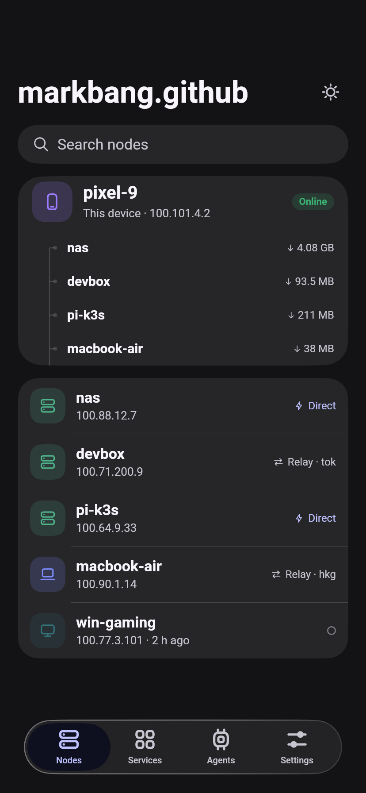
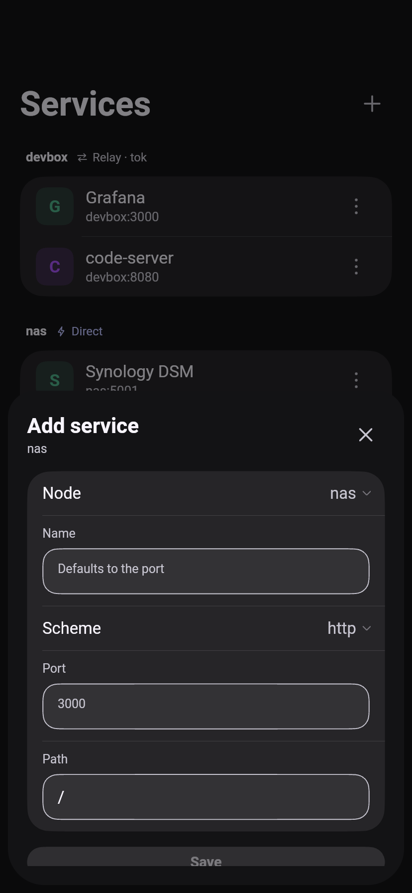
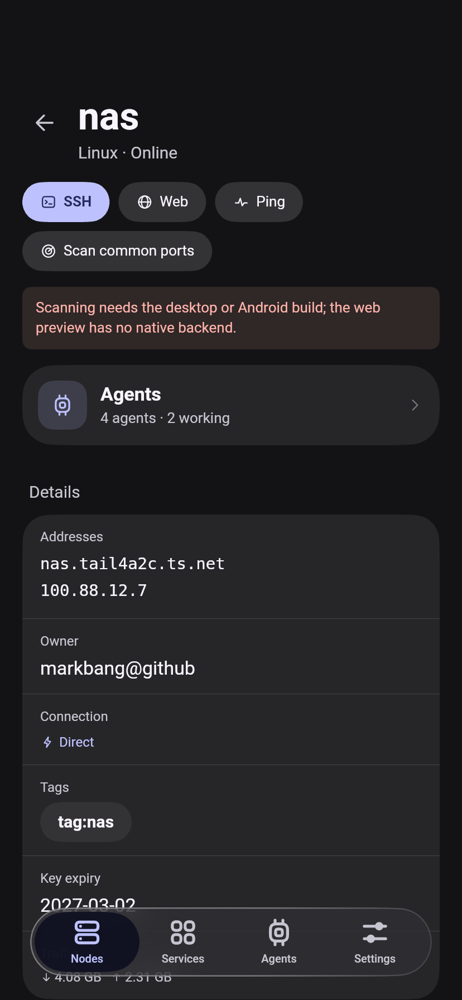
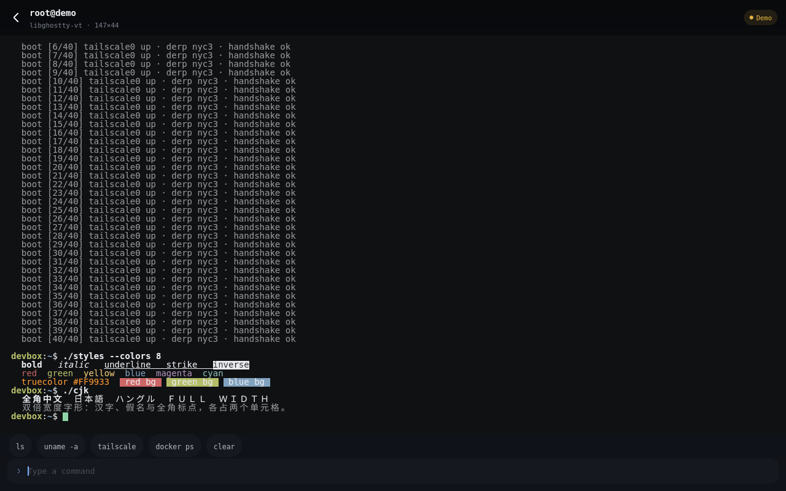

[English](README.md) · [中文](README.zh-CN.md)

# Taildeck · Flutter + prism_ui redesign

[](https://github.com/markbang/taildeck-ui/actions/workflows/pages.yml)
[](LICENSE)

**Live preview:** https://markbang.github.io/taildeck-ui/

A re-design of [Taildeck](https://github.com/markbang/taildeck)'s Android (Jetpack Compose) UI in Flutter,
built on [prism_ui](https://github.com/chen08209/prism_ui) — the iOS-style design system behind FlClash.


| | |
|---|---|
|  |  |
|  |  |
|  |  |
|  |  |
|  |  |

## Platforms

Android releases are signed with the Kotlin app's own key (`top.bangwu.taildeck`, same certificate), so this client
upgrades over the Kotlin app and keeps its data; [docs/SIGNING.md](docs/SIGNING.md) covers the identity, the keystore
and the CI secrets, and which Windows/macOS/iOS certificates are still missing.

**Android and Linux** run the real thing. The app loads the Go tsnet node from
[markbang/taildeck](https://github.com/markbang/taildeck) over `dart:ffi`: sign in with a browser or an auth key,
see peers with direct/relay paths, ping them, open SSH sessions (Tailscale SSH, password, the built-in ed25519 key
or an imported key, with host-key trust) and use a [libghostty-vt](https://github.com/ghostty-org/ghostty)
terminal. Services are stored locally and can be added, edited, deleted, scanned, and opened in the default browser
through the `127.0.0.1:18680` gateway; Agents read and drive herdr on a node over the same SSH connection.

**Windows, macOS and iOS** have the native libraries wired (a DLL, a dylib, a static archive) and build unsigned in
CI on a tag or a manual run (`.github/workflows/platform-release.yml`). None of them has been run yet; iOS also
still needs its Dart side to open the linked archive, so it falls back to mock data until then.

**Web** at https://markbang.github.io/taildeck-ui/ stays a UI preview: mock data, a simulated terminal and no
tailnet.

Known gap: the machine this was built on has no Tailscale control-plane access and no auth key, so login, peer
lists, SSH, herdr and port scans are implemented but have not been verified end to end. CI builds the Android APK;
no device has run it. [docs/PARITY.md](docs/PARITY.md) lists the state of every feature.

## What changed

The original is a single-accent dark Compose app. This version keeps the dark, dense feel but rebuilds it on
prism_ui's surfaces and stroke-icon engine:

- **Per-OS device badges** — phone / laptop / monitor / server glyphs, tinted per platform, dimmed when offline
- **Self card** — this device plus its active peers, tied together with a continuous elbow line
- **Path badge** — `Direct` (bolt) vs `Relay · tok` as a single compact label instead of a bare dot
- **Node detail** — action pills (SSH / Web / Ping), an Agents summary card, then one grouped details card,
  including last-seen and key-expiry dates in the app's language
- **Services** — grouped by node with the node's own path state in the section header; add and edit with node,
  scheme, port and path, delete with a confirmation, and a 32-port scan through the node
- **Agents (herdr)** — on Android/Linux the list, states and transcripts come from a real herdr server on a node,
  over the same SSH connection as the terminal: sections by workspace, state pills (Working / Blocked / Idle / Done),
  the pane's title and `kind · pane`, a connection card that explains `HERDR_NOT_INSTALLED` / `HERDR_NOT_RUNNING`,
  and a chat page with the agent's transcript, a prompt box, restart and `/model` switching. The web preview keeps
  the demo list, and "New agent" really starts an agent (`workspace.create` + `agent.start`) when connected
- **Navigation matches FlClash** — same prism_ui shell: `PageView` + `KeepScope` (pages keep their scroll state and
  slide on switch), sidebar inside `AnimatedVisibility.sidebar` on a chrome surface with a divider, floating
  `NavigationDock` in `BarItemPresence.held` + `AnimatedVisibility.bottomNavigation`, and a docked `NavigationBar`
  variant you can switch to in Settings, and a Slide / Fade tab animation (fade cancels the slide and
  cross-fades in place, using prism_ui's `fadeTabDuration` / `fadeTabCurve`)
- **Login** — browser sign-in with a waiting state, auth key entry, optional control server field
- **SSH sheet** — user / port / authentication pickers built on prism_ui's `PopupAnchor` + `PopupMenu`
  (checked items), presented as a form sheet; the choice flows into the terminal header
- **SSH terminal** — full-bleed mono session with a working input line (`ls`, `uname`, `tailscale`, `docker ps` … are
  simulated on Web), bundled DejaVu Sans Mono. On Android and Linux the grid is painted from real
  [libghostty-vt](https://github.com/ghostty-org/ghostty) snapshots over `dart:ffi` and fed by a real SSH session;
  `/?ssh=demo` shows a canned ANSI session (colors, bold/underline, wide CJK, scrollback) without a tailnet
- **Settings** — tailnet and device info, service open mode, navigation and tab motion, SSH identities (built-in
  key, imported PEM keys), forget trusted hosts, logs, sign-out
- **Bilingual** — English and Chinese, switchable in Settings (or `?lang=zh`); every screen, plus prism_ui's own
  strings through `UiLocalizations`
- **Accessibility** — screen-reader labels, Esc to dismiss, prism_ui's reduce-motion setting honoured, and text
  kept readable from 0.9 to 1.3 scale
- **Self-contained fonts** — Roboto, DejaVu Sans Mono and a Noto Sans CJK subset (SC/TC/JP/KR) ship with the app, and the build uses `--no-web-resources-cdn`, so nothing is fetched from `fonts.gstatic.com` / `www.gstatic.com` at runtime (that CDN is unreliable from mainland China)
- **Responsive** — sidebar above 720 dp, glass dock below, both from prism_ui

## Structure

```
lib/src/
  app.dart        PrismApp, theme + view scope
  shell.dart      sidebar ↔ dock, node detail / agents stack, ?tab= & ?node= preview params
  backend.dart    node state, peers, services, keys, logs; mock fallback on Web
  herdr.dart      herdr link, agents, transcripts, prompts
  services.dart   saved services, port list, gateway URLs
  native/         dart:ffi bridge, terminal, SSH, keys, storage, platform hooks
  data.dart       sample tailnet for the Web preview
  l10n.dart       UiLocalizations for prism_ui's own strings
  pages/          login · nodes · node_detail · services · agents · agent_chat · settings · logs · terminal
  widgets/        PageBody, GroupCard, NodeBadge, PathBadge, StatusPill, Connector, ServiceTile, ActionPill
```

Preview params: `/?tab=1` (services), `/?tab=2` (agents), `/?tab=3` (settings), `/?node=devbox` (node detail),
`/?theme=light`, `/?nav=docked` (docked bottom bar instead of the floating dock), `/?anim=fade`,
`/?login=1` (sign-in), `/?login=waiting` (device approval pending), `/?preview=1` (signed-in shell without a
node), `/?ssh=devbox` (terminal), `/?lang=zh`,
`/?ssh=demo` (native libghostty-vt demo session), `/?chat=w1:p1` (a pane's chat on the native build; without a
herdr connection it shows the real error state), `/?chat=w1:p1&status=working` (the same chat with the agent
busy, so the prompt queue shows), `/?chat=w1:p1&queue=first%20prompt|second` (prompts that start out queued),
`/?motion=off` (preview the system's reduce-motion setting),
`/?scale=1.3` (preview a text scale; the app clamps 0.9–1.3). The desktop bundle has no URL, so pass the same
parameters as `TAILDECK_QUERY=ssh=demo`.

## Run

```bash
source tool/env.sh          # China mirrors + Flutter 3.47.9
flutter pub get
flutter run -d web-server --web-port 8099
```

A native build needs its libraries first: `tool/build_native.sh` and `tool/build_term.sh`.

## herdr agents

The Agents tab talks to [herdr](https://github.com/markbang/herdr) on a tailnet node. It logs in with the node's
SSH credentials (Tailscale SSH, a key from Settings, or a password), attaches to the herdr socket and re-reads
`agent.list` whenever herdr reports a change. The connection target is remembered in `config.json`; the password
never is.

```bash
tool/build_native.sh          # Go ABI: td_herdr_connect / _call / _transcript / _restart / _models / _close
dart run tool/ffi_smoke.dart  # exports and clean error envelopes, no network
```

Still missing under herdr, compared with the Kotlin app: per-node SSH profiles (this build keeps one herdr target),
notification actions (allow/deny, reply), prompt queues while an agent works, subagent transcripts, image
attachments and slash-command completion. [docs/PARITY.md](docs/PARITY.md) has the full list. A live tailnet and a
running herdr server were not available here, so real panes and streaming are unverified.

## Native terminal

```bash
tool/build_term.sh          # libghostty-vt + the C shim: linux/lib/ and android jniLibs/
dart run tool/term_smoke.dart   # FFI smoke test against a real 80x24 terminal
flutter build linux --release   # bundles linux/lib/libtaildeck_term.so next to the executable
```

## Fonts

`assets/fonts` holds the UI font (Roboto), the terminal font (DejaVu Sans Mono) and
`NotoSansCJK-subset.otf` (6 MB: CJK ideographs, kana, Hangul, CJK punctuation, fullwidth forms).
Regenerate it narrower when you know your text:

```bash
pyftsubset /usr/share/fonts/opentype/noto/NotoSansCJK-Regular.ttc --font-number=2 \
  --unicodes="U+3000-303F,U+3040-30FF,U+4E00-9FFF,U+AC00-D7A3,U+FF00-FFEF" \
  --output-file=assets/fonts/NotoSansCJK-subset.otf --layout-features='' --no-hinting
```

Drop `U+AC00-D7A3` to save ~1.1 MB if Korean is not needed.

## Status

M0–M4 have landed: the native bridge and terminal FFI, SSH sessions, services and the gateway, herdr agents,
settings, keys and logs, Android host network hooks, and unsigned Windows/macOS/iOS packaging. See
[docs/PARITY.md](docs/PARITY.md) for the feature-by-feature comparison with the Kotlin app,
[docs/ARCHITECTURE.md](docs/ARCHITECTURE.md) for the native boundary and [docs/SIGNING.md](docs/SIGNING.md) for the
release signing.

Still missing: an in-app WebView (links open in the system browser), notification actions with allow/deny/reply,
prompt queues while an agent is busy, subagent transcripts, image attachments, slash-command completion, and an
Android foreground service that keeps the node alive when the app is backgrounded. Verification is blocked by the
missing tailnet access above, not by missing code.

## Licenses

prism_ui and Taildeck are GPL-3.0; this redesign inherits that. `third_party/prism_ui` is a vendored 0.1.2 with
two local patches: a web fix (`SceneBuilder.pushClipRSuperellipse` needs an explicit `clipBehavior`) and
reduce-motion checks (the sidebar, dock, sheets and menus land at once under `MediaQuery.disableAnimations`).
