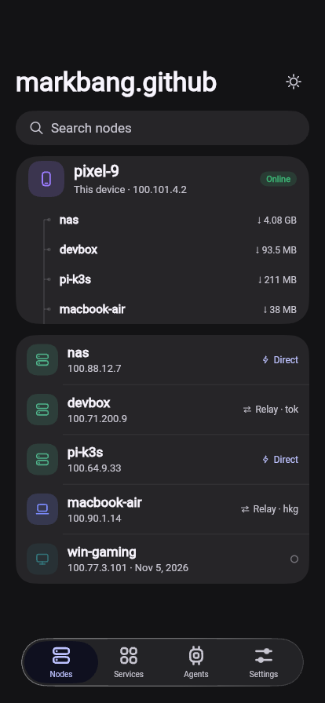
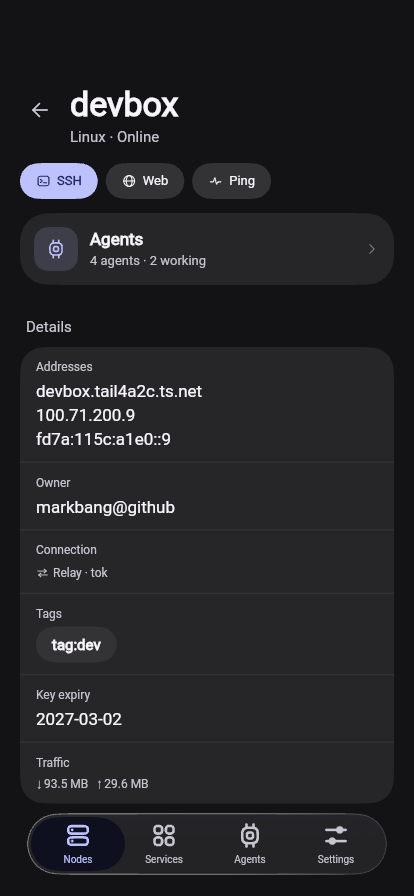
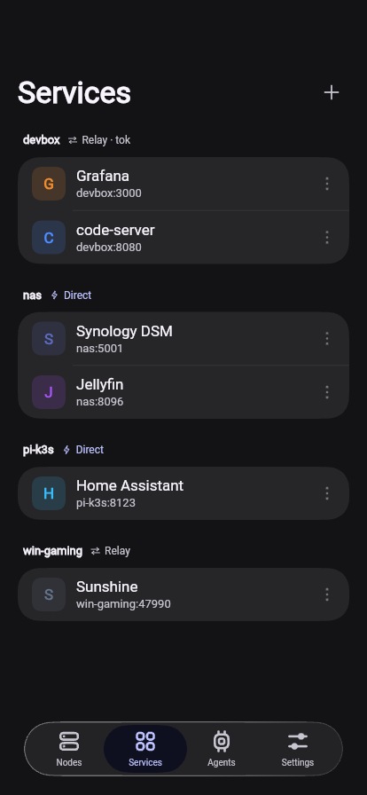
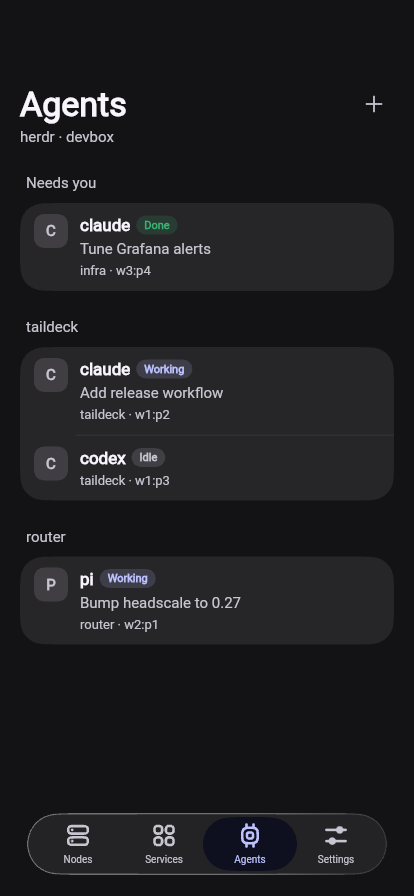
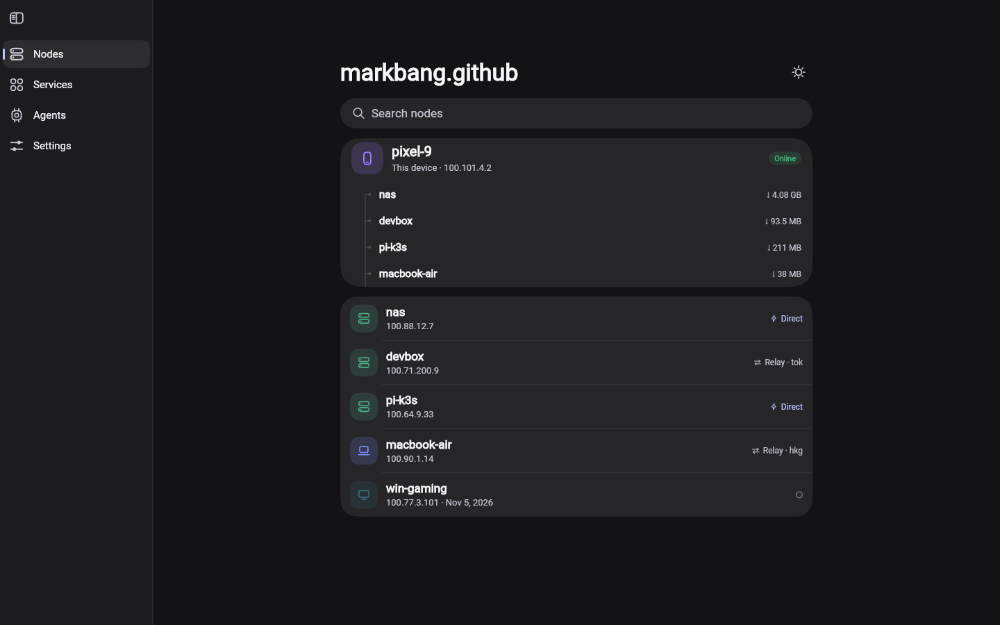

# Taildeck · Flutter + prism_ui redesign

A re-design of [Taildeck](https://github.com/markbang/taildeck)'s Android (Jetpack Compose) UI in Flutter,
built on [prism_ui](https://github.com/chen08209/prism_ui) — the iOS-style design system behind FlClash.



| | |
|---|---|
|  |  |
|  |  |

## What changed

The original is a single-accent dark Compose app. This version keeps the dark, dense feel but rebuilds it on
prism_ui's surfaces and stroke-icon engine:

- **Per-OS device badges** — phone / laptop / monitor / server glyphs, tinted per platform, dimmed when offline
- **Self card** — this device plus its active peers, tied together with a continuous elbow line
- **Path badge** — `Direct` (bolt) vs `Relay · tok` as a single compact label instead of a bare dot
- **Node detail** — action pills (SSH / Web / Ping), an Agents summary card, then one grouped details card
- **Services** — grouped by node with the node's own path state in the section header
- **Agents** — sections by project, state pills (Working / Idle / Done), task and `project · window` meta
- **Navigation matches FlClash** — same prism_ui shell: `PageView` + `KeepScope` (pages keep their scroll state and
  slide on switch), sidebar inside `AnimatedVisibility.sidebar` on a chrome surface with a divider, floating
  `NavigationDock` in `BarItemPresence.held` + `AnimatedVisibility.bottomNavigation`, and a docked `NavigationBar`
  variant you can switch to in Settings, and a Slide / Fade tab animation (fade cancels the slide and
  cross-fades in place, using prism_ui's `fadeTabDuration` / `fadeTabCurve`)
- **Responsive** — sidebar above 720 dp, glass dock below, both from prism_ui

## Structure

```
lib/src/
  app.dart       PrismApp, theme + view scope
  shell.dart     sidebar ↔ dock, node detail / agents stack, ?tab= & ?node= preview params
  theme.dart     seed color, dark-first, light supported
  glyphs.dart    stroke icons (nodes, agents, terminal, relay, sun …)
  data.dart      sample tailnet: self, peers, services, agents
  l10n.dart      UiLocalizations for prism_ui's own strings
  pages/         nodes · node_detail · services · agents · settings
  widgets/       PageBody, GroupCard, NodeBadge, PathBadge, StatusPill, Connector, ServiceTile, ActionPill
```

Preview params: `/?tab=1` (services), `/?tab=2` (agents), `/?tab=3` (settings), `/?node=devbox` (node detail),
`/?theme=light`, `/?nav=docked` (docked bottom bar instead of the floating dock), `/?anim=fade`.

## Run

```bash
source tool/env.sh          # 国内镜像 + Flutter 3.47.9
flutter pub get
flutter run -d web-server --web-port 8099
```

## Status

This is a **UI layer**, not a port of the Android app. Everything is sample data in `data.dart`; there is no
tsnet, SSH terminal, WebView gateway or keystore. Wiring it up would mean swapping `data.dart` for your
existing Kotlin bridge (or a `tsnet`-backed FFI plugin) and keeping these pages as the view.

## Licenses

prism_ui and Taildeck are GPL-3.0; this redesign inherits that. `third_party/prism_ui` is a vendored 0.1.2 with
one web fix (`SceneBuilder.pushClipRSuperellipse` needs an explicit `clipBehavior`), documented in the repo.
