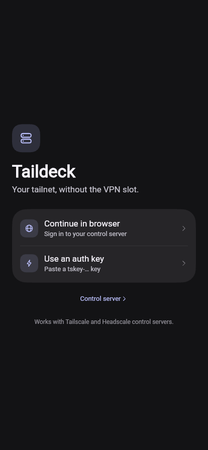
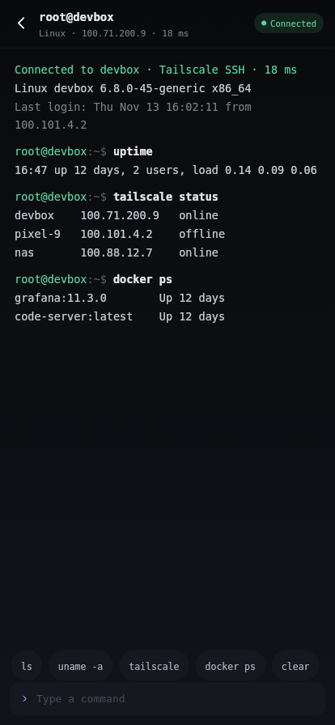

[English](README.md) · [中文](README.zh-CN.md)

# Taildeck · Flutter + prism_ui redesign

[](https://github.com/markbang/taildeck-ui/actions/workflows/pages.yml)
[](LICENSE)

**Live preview:** https://markbang.github.io/taildeck-ui/

A re-design of [Taildeck](https://github.com/markbang/taildeck)'s Android (Jetpack Compose) UI in Flutter,
built on [prism_ui](https://github.com/chen08209/prism_ui) — the iOS-style design system behind FlClash.


| | |
|---|---|
|  |  |
|  |  |
|  |  |

## Platforms

The Web build at https://markbang.github.io/taildeck-ui/ is a **UI preview only**: it runs on mock data and has
no native backend, so it cannot join a tailnet, open SSH sessions or run real agents.

The native clients — Android, Linux, Windows, macOS and iOS — are in progress, Android and Linux first. One Flutter
codebase drives all of them; the native boundary (tsnet node, terminal, gateway) is planned in
[docs/ARCHITECTURE.md](docs/ARCHITECTURE.md) and is not implemented yet.

## What changed

The original is a single-accent dark Compose app. This version keeps the dark, dense feel but rebuilds it on
prism_ui's surfaces and stroke-icon engine:

- **Per-OS device badges** — phone / laptop / monitor / server glyphs, tinted per platform, dimmed when offline
- **Self card** — this device plus its active peers, tied together with a continuous elbow line
- **Path badge** — `Direct` (bolt) vs `Relay · tok` as a single compact label instead of a bare dot
- **Node detail** — action pills (SSH / Web / Ping), an Agents summary card, then one grouped details card
- **Services** — grouped by node with the node's own path state in the section header
- **Agents** — sections by project, state pills (Working / Idle / Done), task and `project · window` meta;
  "New agent" opens a sheet with harness and project selects plus a task field, and the list updates in place
- **Navigation matches FlClash** — same prism_ui shell: `PageView` + `KeepScope` (pages keep their scroll state and
  slide on switch), sidebar inside `AnimatedVisibility.sidebar` on a chrome surface with a divider, floating
  `NavigationDock` in `BarItemPresence.held` + `AnimatedVisibility.bottomNavigation`, and a docked `NavigationBar`
  variant you can switch to in Settings, and a Slide / Fade tab animation (fade cancels the slide and
  cross-fades in place, using prism_ui's `fadeTabDuration` / `fadeTabCurve`)
- **Login** — browser sign-in with a waiting state, auth key entry, optional control server field
- **SSH sheet** — user / port / authentication pickers built on prism_ui's `PopupAnchor` + `PopupMenu`
  (checked items), presented as a form sheet; the choice flows into the terminal header
- **SSH terminal** — full-bleed mono session with a working input line (`ls`, `uname`, `tailscale`, `docker ps` … are simulated
  on Web), bundled DejaVu Sans Mono. On Android and Linux the grid is painted from real
  [libghostty-vt](https://github.com/ghostty-org/ghostty) snapshots over `dart:ffi`; the SSH session itself is
  the next milestone, so `/?ssh=demo` shows a canned ANSI session (colors, bold/underline, wide CJK, scrollback)
- **Bilingual** — English and Chinese, switchable in Settings (or `?lang=zh`); every screen, plus prism_ui's own
  strings through `UiLocalizations`
- **Self-contained fonts** — Roboto, DejaVu Sans Mono and a Noto Sans CJK subset (SC/TC/JP/KR) ship with the app, and the build uses `--no-web-resources-cdn`, so nothing is fetched from `fonts.gstatic.com` / `www.gstatic.com` at runtime (that CDN is unreliable from mainland China)
- **Responsive** — sidebar above 720 dp, glass dock below, both from prism_ui

## Structure

```
lib/src/
  app.dart       PrismApp, theme + view scope
  shell.dart     sidebar ↔ dock, node detail / agents stack, ?tab= & ?node= preview params
  theme.dart     seed color, dark-first, light supported
  glyphs.dart    stroke icons (nodes, agents, terminal, relay, sun …)
  data.dart      sample tailnet: self, peers, services, agents
  l10n.dart      UiLocalizations for prism_ui's own strings
  pages/         login · nodes · node_detail · services · agents · settings · terminal
  widgets/       PageBody, GroupCard, NodeBadge, PathBadge, StatusPill, Connector, ServiceTile, ActionPill
```

Preview params: `/?tab=1` (services), `/?tab=2` (agents), `/?tab=3` (settings), `/?node=devbox` (node detail),
`/?theme=light`, `/?nav=docked` (docked bottom bar instead of the floating dock), `/?anim=fade`,
`/?login=1` (sign-in), `/?login=waiting` (device approval pending), `/?ssh=devbox` (terminal), `/?lang=zh`,
`/?ssh=demo` (native libghostty-vt demo session). The desktop bundle has no URL, so pass the same parameters as
`TAILDECK_QUERY=ssh=demo`.

## Run

```bash
source tool/env.sh          # China mirrors + Flutter 3.47.9
flutter pub get
flutter run -d web-server --web-port 8099
```

## Native terminal

```bash
tool/build_term.sh          # libghostty-vt + the C shim: linux/lib/ and android jniLibs/
dart run tool/term_smoke.dart   # FFI smoke test against a real 80x24 terminal
flutter build linux --release   # bundles linux/lib/libtaildeck_term.so next to the executable
```

## Fonts

`assets/fonts` holds the UI font (Roboto), the terminal font (DejaVu Sans Mono) and
`NotoSansCJK-subset.otf` (6 MB: CJK ideographs, kana, Hangul, CJK punctuation, fullwidth forms).
Regenerate it narrower when you know your text:

```bash
pyftsubset /usr/share/fonts/opentype/noto/NotoSansCJK-Regular.ttc --font-number=2 \
  --unicodes="U+3000-303F,U+3040-30FF,U+4E00-9FFF,U+AC00-D7A3,U+FF00-FFEF" \
  --output-file=assets/fonts/NotoSansCJK-subset.otf --layout-features='' --no-hinting
```

Drop `U+AC00-D7A3` to save ~1.1 MB if Korean is not needed.

## Status

This is a **UI layer**, not yet a port of the Android app. Everything is sample data in `data.dart`; the terminal
echoes a few simulated commands and there is no tsnet, WebView gateway or keystore. The native boundary that replaces
`data.dart` is planned in [docs/ARCHITECTURE.md](docs/ARCHITECTURE.md): the Go `bridge/` module behind a C ABI, a
`libghostty-vt` terminal, one Flutter UI for every platform.

## Licenses

prism_ui and Taildeck are GPL-3.0; this redesign inherits that. `third_party/prism_ui` is a vendored 0.1.2 with
one web fix (`SceneBuilder.pushClipRSuperellipse` needs an explicit `clipBehavior`), documented in the repo.
