中文 · [English](README.md)

# Taildeck · Flutter + prism_ui 重设计

[](https://github.com/markbang/taildeck-ui/actions/workflows/pages.yml)
[](LICENSE)

**在线预览：** https://markbang.github.io/taildeck-ui/

用 Flutter 重做 [Taildeck](https://github.com/markbang/taildeck) 的 Android（Jetpack Compose）界面，基于
[prism_ui](https://github.com/chen08209/prism_ui) —— FlClash 使用的 iOS 风格设计系统。

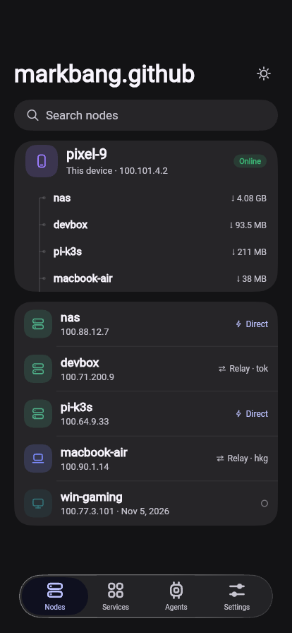

| | |
|---|---|
| 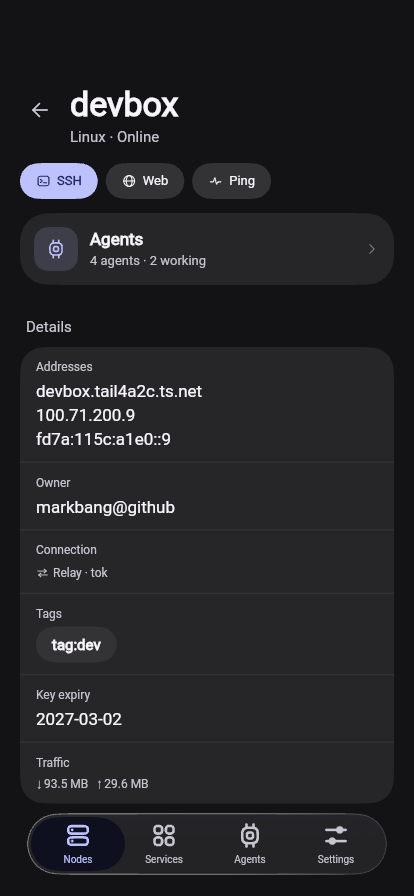 | 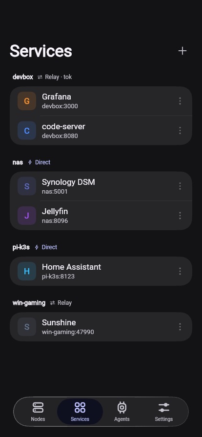 |
| 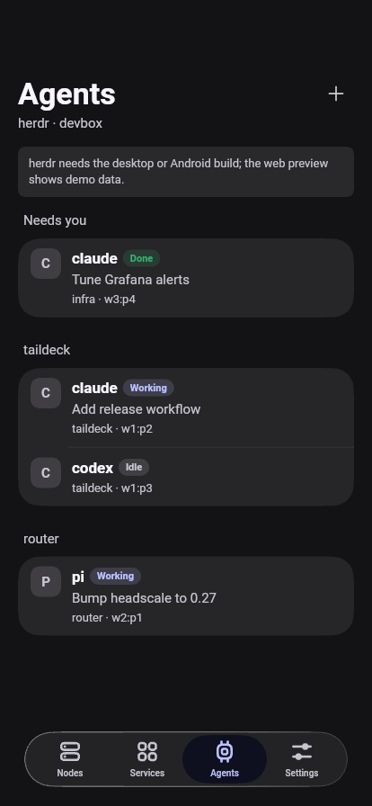 | 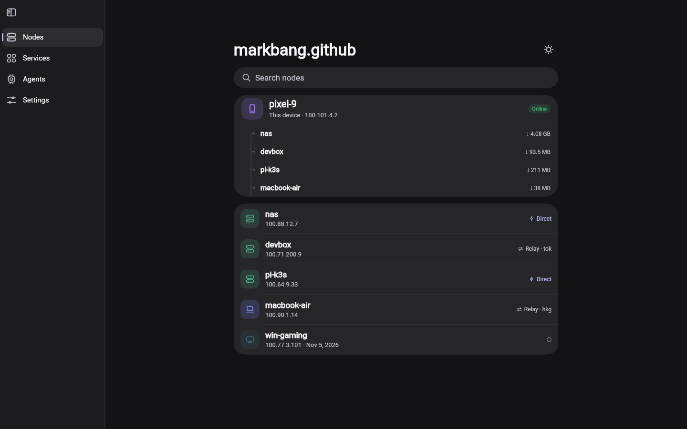 |
| 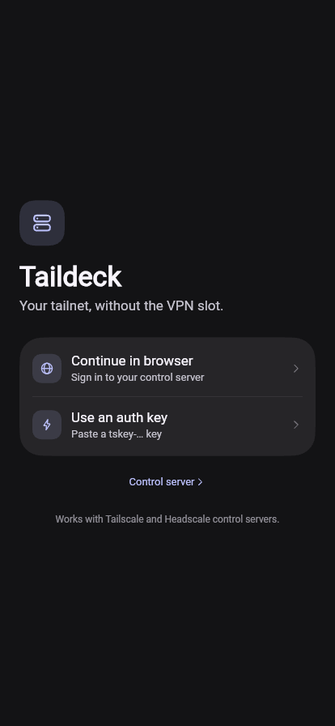 | 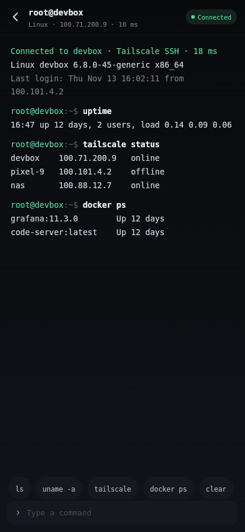 |
| 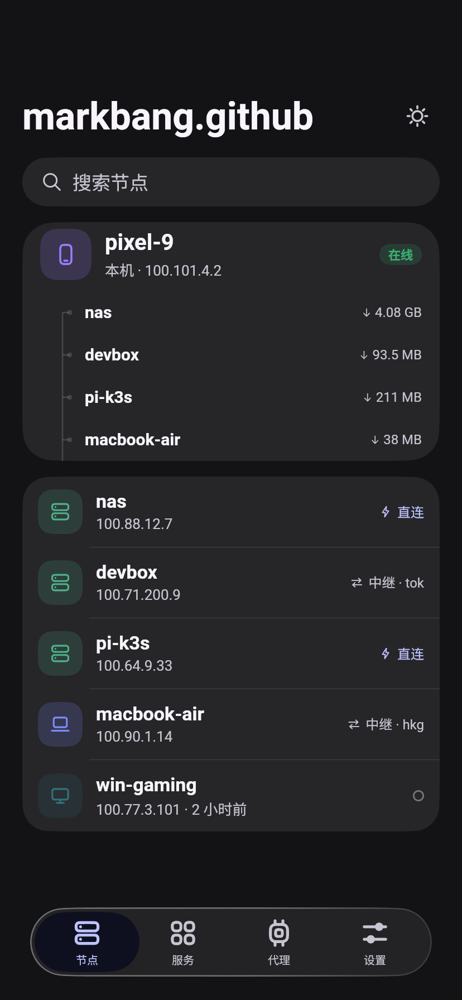 | 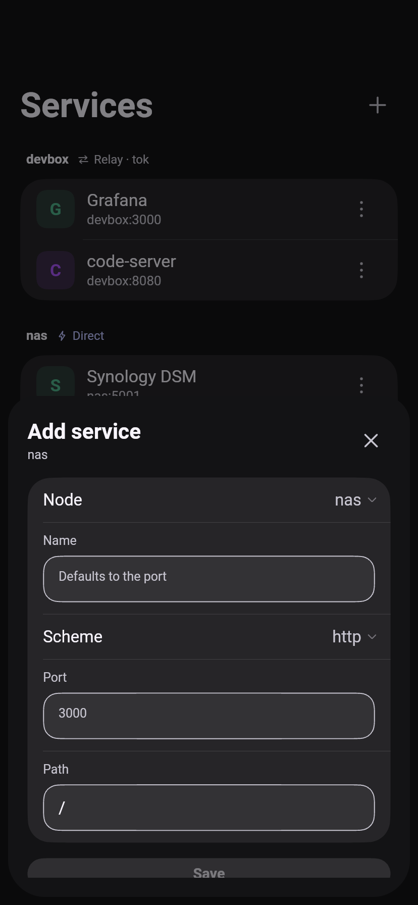 |
| 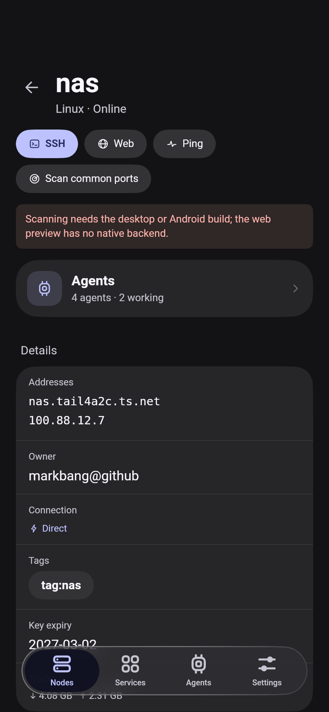 | 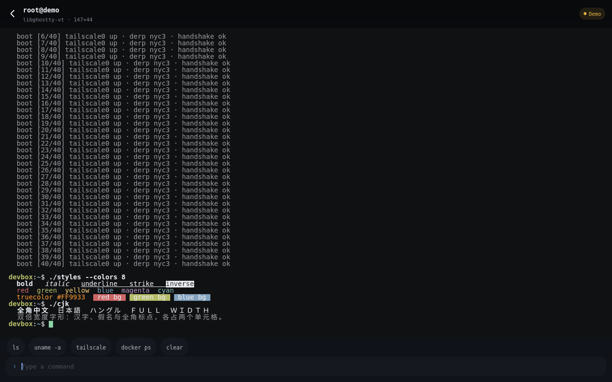 |

## 平台

**Android 和 Linux** 跑的是真东西。应用通过 `dart:ffi` 加载 [markbang/taildeck](https://github.com/markbang/taildeck)
里的 Go tsnet 节点：可以浏览器登录或使用 auth key，查看带直连/中继路径的对端并 ping，打开 SSH 会话
（Tailscale SSH、密码、内置 ed25519 密钥或导入的密钥，支持主机密钥信任），并使用
[libghostty-vt](https://github.com/ghostty-org/ghostty) 终端。服务保存在本地，可添加、编辑、删除、扫描，并经
`127.0.0.1:18680` 网关用默认浏览器打开；Agents 通过与终端相同的 SSH 连接读取并操作节点上的 herdr。

**Windows、macOS 和 iOS** 已接好原生库（DLL、dylib、静态库），在打 tag 或手动触发时由 CI 构建未签名包
（`.github/workflows/platform-release.yml`）。三者都还没运行过；iOS 的 Dart 侧还不会加载链接进来的静态库，
在此之前会回退到模拟数据。

**Web**（https://markbang.github.io/taildeck-ui/）仍然只是界面预览：模拟数据、模拟终端，没有 tailnet。

已知缺口：构建这台机器无法访问 Tailscale 控制面，也没有 auth key，所以登录、对端列表、SSH、herdr 和端口扫描
虽已实现，却没有端到端验证过。CI 只构建 Android APK，没有真机跑过。每项功能的状态见
[docs/PARITY.zh-CN.md](docs/PARITY.zh-CN.md)。

## 改动内容

原版是一个单强调色的深色 Compose 应用。这一版保留深色、紧凑的观感，但改用 prism_ui 的表面和描边图标体系重新搭建：

- **按系统区分的设备徽标** —— 手机 / 笔记本 / 显示器 / 服务器字形，按平台着色，离线时变暗
- **本机卡片** —— 本机与活跃对端连成一条折线
- **路径徽标** —— `Direct`（闪电）与 `Relay · tok` 合成一个紧凑标签，取代原来的小圆点
- **节点详情** —— 操作胶囊（SSH / Web / Ping）、Agents 摘要卡片，然后是一张分组信息卡，最后在线和密钥到期
  日期按应用语言显示
- **服务** —— 按节点分组，分区标题里带该节点自己的路径状态；添加/编辑可选节点、协议、端口和路径，删除带确认，
  并可经节点扫描 32 个常用端口
- **Agents（herdr）** —— Android/Linux 上代理列表、状态和会话记录来自节点上的真实 herdr 服务，走与终端相同的
  SSH 连接：按工作区分区，状态胶囊（运行中 / 待确认 / 空闲 / 已完成），显示 pane 标题和 `kind · pane`；
  连接卡片会说明 `HERDR_NOT_INSTALLED` / `HERDR_NOT_RUNNING`；聊天页显示会话记录、输入框、重启和 `/model` 切换。
  网页预览仍用演示列表；连接后 “新建代理” 会真正启动代理（`workspace.create` + `agent.start`）
- **导航与 FlClash 一致** —— 同一套 prism_ui 外壳：`PageView` + `KeepScope`（切页时保留滚动位置并滑动切换），
  侧边栏放在带分隔线的 chrome 表面上的 `AnimatedVisibility.sidebar` 里，浮动 `NavigationDock` 使用
  `BarItemPresence.held` + `AnimatedVisibility.bottomNavigation`，另可在设置里切换到停靠式 `NavigationBar`；
  标签切换支持滑动 / 淡入（Fade）两种动画，淡入会取消滑动并原地交叉淡化，使用 prism_ui 的
  `fadeTabDuration` / `fadeTabCurve`
- **登录** —— 浏览器登录及等待状态、auth key 输入、可选的控制服务器地址
- **SSH 表单** —— 用户 / 端口 / 认证方式选择器基于 prism_ui 的 `PopupAnchor` + `PopupMenu`（勾选样式），
  以表单弹层呈现；选择结果带入终端标题栏
- **SSH 终端** —— 通栏等宽会话，输入行可用（Web 上 `ls`、`uname`、`tailscale`、`docker ps` 等为模拟输出），
  内置 DejaVu Sans Mono。Android 和 Linux 上画面由真实的 [libghostty-vt](https://github.com/ghostty-org/ghostty)
  快照经 `dart:ffi` 绘制，并接真实 SSH 会话；没有 tailnet 时 `/?ssh=demo` 会放一段固定的 ANSI 会话
  （颜色、粗体/下划线、宽字符 CJK、回滚）
- **设置** —— tailnet 与设备信息、服务打开方式、导航与切页动画、SSH 身份（内置密钥、导入 PEM 密钥）、
  清除已信任主机、日志、退出登录
- **中英双语** —— 英文和中文，可在设置（或 `?lang=zh`）切换；所有界面文案，以及 prism_ui 自己的字符串
  （通过 `UiLocalizations`）都已覆盖
- **无障碍** —— 读屏标签、Esc 关闭、遵循 prism_ui 的减少动态效果设置，文字在 0.9–1.3 缩放下保持可读
- **字体自带** —— Roboto、DejaVu Sans Mono 和一份 Noto Sans CJK 子集（SC/TC/JP/KR）随应用打包，构建使用
  `--no-web-resources-cdn`，运行时不从 `fonts.gstatic.com` / `www.gstatic.com` 取任何资源（该 CDN 在
  中国大陆不稳定）
- **自适应** —— 720 dp 以上用侧边栏，以下用玻璃质感底栏，均来自 prism_ui

## 结构

```
lib/src/
  app.dart        PrismApp，主题 + 视图作用域
  shell.dart     侧边栏 ↔ 底栏、节点详情 / agents 叠层、?tab= 与 ?node= 预览参数
  backend.dart   节点状态、对端、服务、密钥、日志；Web 上回退到模拟数据
  herdr.dart     herdr 连接、agents、会话记录、输入
  services.dart  保存的服务、端口表、网关 URL
  native/        dart:ffi 桥接、终端、SSH、密钥、存储、平台钩子
  data.dart      网页预览用的示例 tailnet
  l10n.dart      覆盖 prism_ui 自身字符串的 UiLocalizations
  pages/         login · nodes · node_detail · services · agents · agent_chat · settings · logs · terminal
  widgets/       PageBody、GroupCard、NodeBadge、PathBadge、StatusPill、Connector、ServiceTile、ActionPill
```

预览参数：`/?tab=1`（服务）、`/?tab=2`（agents）、`/?tab=3`（设置）、`/?node=devbox`（节点详情）、
`/?theme=light`、`/?nav=docked`（停靠式底栏替代浮动底栏）、`/?anim=fade`、
`/?login=1`（登录）、`/?login=waiting`（等待设备批准）、`/?preview=1`（无节点也能看已登录界面）、
`/?ssh=devbox`（终端）、`/?lang=zh`、
`/?ssh=demo`（原生 libghostty-vt 演示会话）、`/?chat=w1:p1`（原生构建下某个 pane 的聊天页；没有 herdr 连接时
显示真实的错误状态）、`/?motion=off`（预览系统的「减少动态效果」）、`/?scale=1.3`（预览文字缩放，应用会限制在
0.9–1.3）。桌面版没有 URL，用 `TAILDECK_QUERY=ssh=demo` 传同样的参数。

## 运行

```bash
source tool/env.sh          # 国内镜像 + Flutter 3.47.9
flutter pub get
flutter run -d web-server --web-port 8099
```

原生构建需要先生成原生库：`tool/build_native.sh` 和 `tool/build_term.sh`。

## herdr 代理

Agents 标签页连接节点上的 [herdr](https://github.com/markbang/herdr)：用节点的 SSH 凭据（Tailscale SSH、设置里的
密钥或密码）登录，接入 herdr socket，并在 herdr 报告变化时重新读取 `agent.list`。连接目标保存在 `config.json`，
密码不会写入。

```bash
tool/build_native.sh          # Go ABI：td_herdr_connect / _call / _transcript / _restart / _models / _close
dart run tool/ffi_smoke.dart  # 导出符号与错误信封，不需要网络
```

与 Kotlin 版相比，herdr 部分尚未实现：按节点保存的 SSH 配置（这里只有一个 herdr 目标）、通知里的允许/拒绝与
回复、代理忙时的消息队列、子代理会话、图片附件、斜杠命令补全，完整列表见
[docs/PARITY.zh-CN.md](docs/PARITY.zh-CN.md)。这里没有可用的 tailnet 和运行中的 herdr，真实的 pane 列表和流式
更新未经验证。

## 原生终端

```bash
tool/build_term.sh              # libghostty-vt + C shim：linux/lib/ 与 Android jniLibs/
dart run tool/term_smoke.dart   # 对真实 80x24 终端跑 FFI 冒烟测试
flutter build linux --release   # 把 linux/lib/libtaildeck_term.so 装进可执行文件旁的 lib/
```

## 字体

`assets/fonts` 存放界面字体（Roboto）、终端字体（DejaVu Sans Mono）和
`NotoSansCJK-subset.otf`（6 MB：CJK 汉字、假名、谚文、CJK 标点、全角字符）。
确定文案后可以再裁剪：

```bash
pyftsubset /usr/share/fonts/opentype/noto/NotoSansCJK-Regular.ttc --font-number=2 \
  --unicodes="U+3000-303F,U+3040-30FF,U+4E00-9FFF,U+AC00-D7A3,U+FF00-FFEF" \
  --output-file=assets/fonts/NotoSansCJK-subset.otf --layout-features='' --no-hinting
```

不需要韩文时去掉 `U+AC00-D7A3` 可省约 1.1 MB。

## 状态

M0–M4 已落地：原生桥接与终端 FFI、SSH 会话、服务与网关、herdr agents、设置/密钥/日志、Android 网络钩子，
以及未签名的 Windows/macOS/iOS 打包。与 Kotlin 版逐项对比见 [docs/PARITY.zh-CN.md](docs/PARITY.zh-CN.md)，
原生边界见 [docs/ARCHITECTURE.zh-CN.md](docs/ARCHITECTURE.zh-CN.md)。

仍缺：应用内 WebView（链接目前在系统浏览器打开）、通知里的允许/拒绝/回复、代理忙时的消息队列、子代理会话、
图片附件、斜杠命令补全，以及让节点在退到后台后继续运行的 Android 前台服务。验证卡在上面说的 tailnet 访问，
不是缺代码。

## 许可

prism_ui 与 Taildeck 均为 GPL-3.0，本重设计沿用该许可。`third_party/prism_ui` 是 vendored 的 0.1.2，附带
两处本地修改：一处 Web 修复（`SceneBuilder.pushClipRSuperellipse` 需要显式 `clipBehavior`），以及「减少动态效果」支持
（侧边栏、Dock、弹层和菜单在 `MediaQuery.disableAnimations` 下即时到位）。
